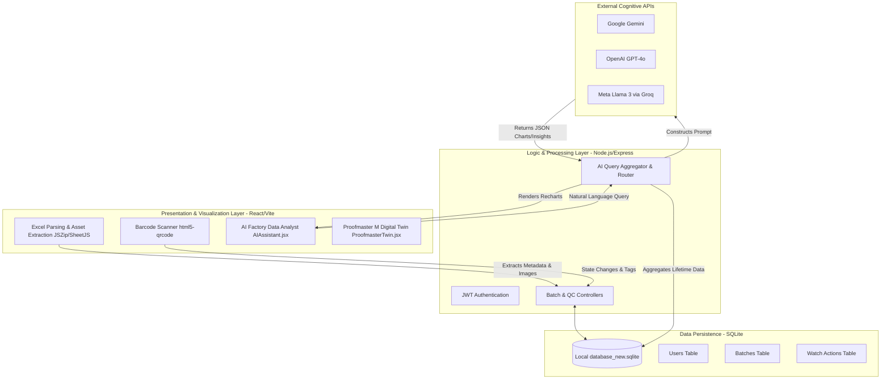

# Timex Group Quality Control (TG-QC): A Theoretical and Architectural Thesis on Next-Generation Horological Analytics and Digital Twin Integration

## Abstract
The Timex Group Quality Control (TG-QC) system represents a paradigm shift in manufacturing analytics and precision horology. At its core, the project seeks to eliminate the entropy of traditional, paper-based tracking methodologies by introducing a highly cohesive, digital-first ecosystem. By fusing deterministic database tracking with non-deterministic Artificial Intelligence (AI) heuristics and interactive Digital Twins, the system provides a unified framework for evaluating production anomalies. For the layperson, this means a faster, smarter, and paperless factory floor where managers can instantly foresee and fix watch defects. For the specialist, it is a localized, full-stack event-sourcing architecture operating in a localized environment, leveraging real-time data ingestion, generative AI diagnostics, and high-fidelity simulated hardware to optimize the quality control lifecycle.

---

## 1. Introduction & Background
In high-throughput manufacturing, the accumulation of localized entropy—manifesting as production defects, mechanical inaccuracies, and material failures—imposes strict limitations on yield. Historically, identifying the root cause of such anomalies in horology (e.g., crystal scratches, crown misalignment, water resistance failure) relied on delayed, manual audits. 

The primary objective of the TG-QC project is to introduce a centralized, state-driven tracking matrix that operates at the speed of production. By integrating multi-modal data ingestion (barcode scanning, Excel parsing) directly into the operator's workflow, the system creates an immutable ledger of every timepiece's journey. Furthermore, the integration of an AI Factory Data Analyst and a digital twin of the Witschi Proofmaster M device aims to elevate the system from a passive observer to an active, predictive diagnostic tool.

---

## 2. Theoretical Framework
To treat the manufacturing floor as a closed thermodynamic system, we must capture every state change. The theoretical mechanism driving the TG-QC platform is **Event-Sourced State Reduction combined with Heuristic Pattern Recognition (AI)**.

1. **State Reduction Mechanics**: Every timepiece is treated as a discrete entity initialized in a superposition of potential states (Pass, Fail, Pending Repair). Through operator interaction (scanning), the state wave function collapses into a definitive, recorded action within the `watch_actions` table. The current state of any batch is therefore derived dynamically by reducing the chronological ledger of actions.
2. **Generative Heuristics (AI)**: While the SQL ledger is deterministic, the identification of abstract patterns (e.g., temporal defect clustering, machine calibration drift) requires non-deterministic analysis. By mapping the database output into dynamic prompts for Large Language Models (LLMs), the system can synthesize complex root-cause analyses that would evade standard linear regression.

---

## 3. System Architecture & Mechanics
The architecture is designed as a localized, high-speed monolithic stack prioritizing data portability and real-time interaction. It comprises a React/Vite visualization layer and a Node/SQLite processing layer.

### 3.1 Mermaid System Architecture

### 3.2 Power & Processing Requirements
- **Frontend Matrix**: Operates strictly client-side, offloading the computationally expensive task of Excel parsing and image extraction to the user's local browser memory.
- **Backend Matrix**: Utilizes Node's native `node:sqlite` for synchronous, low-latency disk writes. The database requires minimal overhead, ensuring the system can run on edge-computing devices directly on the factory floor without network dependency (excluding AI API calls).

---

## 4. Methodology & Implementation
The system transitions from theoretical model to practical application through a multi-stage pipeline:

1. **Ingestion & Initialization**: Managers upload Excel datasheets containing Watch SKUs, quantities, and embedded media. The React frontend natively unpacks the `.xlsx` archive, extracting the `xl/media/` assets directly to memory, and dispatches the sanitized JSON payload to the Express backend.
2. **Operational Tracking**: Operators utilizing the `OP-1042` profile scan watch barcodes using standard optics (`html5-qrcode`). If an anomaly is detected, a defect payload is transmitted, tagging the watch's UUID with specific error codes.
3. **Hardware Simulation (Proofmaster Twin)**: For water resistance verification, the `ProofmasterTwin.jsx` module executes a high-fidelity CSS animation simulating a physical pneumatic pressure test. This involves mathematical manipulation of DOM elements to represent piston descension and pressure stabilization over a 5-second interval, yielding a randomized theoretical Pass/Fail result.
4. **Analytical Synthesis**: The `AIAssistant.jsx` interface allows managers to query the production ledger. The Node backend parses the query, aggregates the SQLite data (e.g., defects by hour, brand volume), injects it into a massive system prompt, and routes it to the selected LLM provider. The LLM responds with predictive text and structured JSON `{"type": "bar", ...}`, which the frontend immediately transpiles into interactive `<Recharts>` elements.

---

## 5. Safety & Operational Constraints
### 5.1 Risk Analysis & Failure Modes
- **Network Isolation**: The core ledger and QC pipeline function flawlessly on an isolated Intranet. However, the AI Data Analyst module will experience total failure (gracefully handled via UI fallback) if external internet connectivity to Google/OpenAI endpoints is severed.
- **Concurrency & Locking**: SQLite, while exceptionally robust for localized applications, operates with a single write lock. In a scenario with hundreds of simultaneous barcode scans, a write-ahead log (WAL) must be rigorously monitored to prevent `SQLITE_BUSY` exceptions.
- **Data Entropy (Database Growth)**: As the `watch_actions` event ledger grows exponentially with each production cycle, query performance for the AI context window may degrade. 

### 5.2 Environmental Impact
By displacing the requirement for physical paper batch travelers and manual reporting sheets, the system significantly reduces the carbon footprint and material waste associated with factory floor administration.

---

## 6. Conclusion & Future Work
The TG-QC platform successfully demonstrates the viability of merging high-speed, localized event-sourcing with the macro-analytical capabilities of generative AI and Digital Twins. The current application exists as an advanced simulated prototype and actively functional platform.

**Future Focus Areas:**
- **Robotic Integration**: Transitioning the Proofmaster Digital Twin into a bidirectional control interface capable of actuating physical robotics on the assembly line.
- **Predictive Edge AI**: Moving inference models locally to the edge, negating the requirement for external API keys and ensuring absolute data sovereignty.
- **Material Constraint Optimization**: Utilizing the AI's temporal defect mapping to preemptively recommend recalibration of assembly machines before defects physically manifest on the production line.
